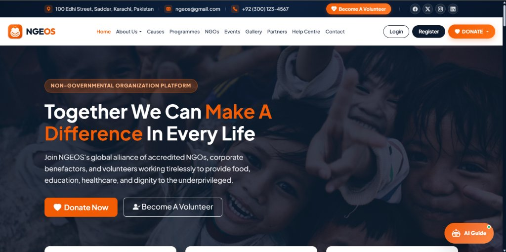
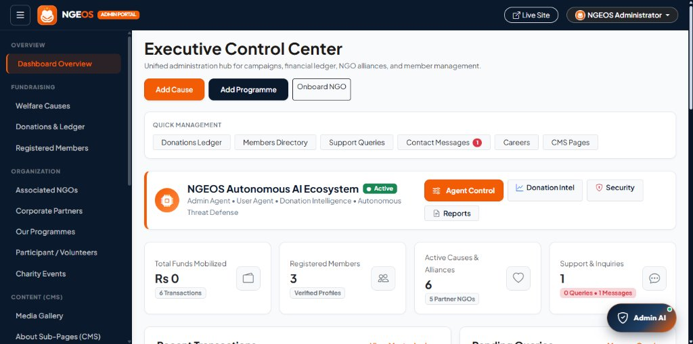
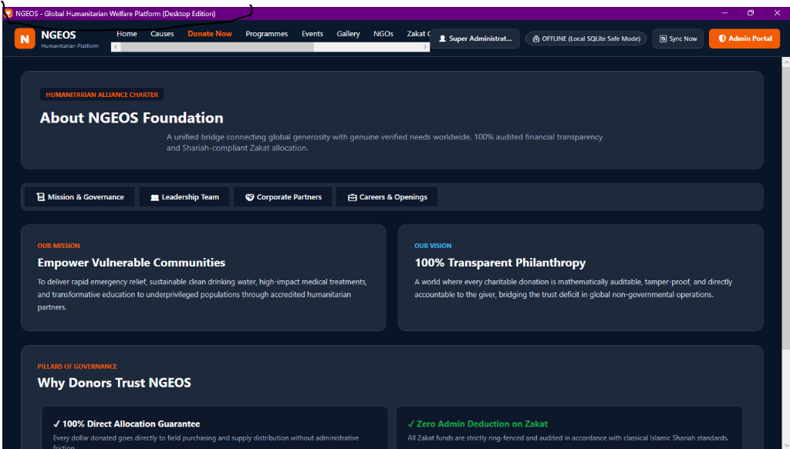

<div align="center">

  

  <br />

  # 🌟 NGEOS — Next-Generation NGO & Welfare Platform
  ### *Comprehensive Non-Governmental Charity Alliance, AI Support Assistant & Desktop Management Platform*

  <br />

  <p align="center">
    Empowering underprivileged communities worldwide across <b>Education</b>, <b>Clean Water</b>, <b>Healthcare</b>, <b>Food Relief</b>, <b>Zakat Management</b>, and <b>Women Empowerment</b>.
  </p>

  <br />

  <!-- LIVE WEBSITE BADGES -->
  <p align="center">
    <a href="https://ngeos.runasp.net" target="_blank">
      
    </a>
    &nbsp;
    <a href="https://ngeos.runasp.net" target="_blank">
      
    </a>
    &nbsp;
    <a href="https://github.com/syedmuhammadsaim/NGEOS">
      
    </a>
  </p>

  <!-- TECH STACK BADGES -->
  <p align="center">
    <a href="https://dotnet.microsoft.com/"></a>
    &nbsp;
    <a href="https://learn.microsoft.com/en-us/dotnet/csharp/"></a>
    &nbsp;
    <a href="https://www.microsoft.com/en-us/sql-server"></a>
    &nbsp;
    <a href="https://learn.microsoft.com/en-us/visualstudio/wpf/"></a>
    &nbsp;
    <a href="https://www.sqlite.org/"></a>
    &nbsp;
    <a href="https://getbootstrap.com/"></a>
    &nbsp;
    <a href="https://groq.com/"></a>
    &nbsp;
    <a href="https://ai.google.dev/"></a>
  </p>

  <br />

  <!-- QUICK NAVIGATION LINKS -->
  <p align="center">
    <a href="#-live-production-website--cloud-deployment-architecture"><b>🌐 Live Site & Architecture</b></a> &nbsp;•&nbsp;
    <a href="#-autonomous-ai-ecosystem-dual-agents"><b>🤖 AI Ecosystem</b></a> &nbsp;•&nbsp;
    <a href="#-system-authentication--credentials"><b>🔑 Authentication & Admin</b></a> &nbsp;•&nbsp;
    <a href="#%EF%B8%8F-api-keys--environment-variables-setup"><b>⚙️ API Keys Setup</b></a> &nbsp;•&nbsp;
    <a href="#-quick-start--installation"><b>🚀 Quick Start</b></a>
    <br />
    <a href="#%EF%B8%8F-database-setup-local-ssms--cloud"><b>🗄️ Database Setup</b></a> &nbsp;•&nbsp;
    <a href="#-cloud-deployment-guide-monsteraspnet"><b>☁️ Cloud Deployment Guide</b></a> &nbsp;•&nbsp;
    <a href="#-desktop-application-mode-100-offline"><b>💻 Desktop Mode</b></a> &nbsp;•&nbsp;
    <a href="#-complete-project-structure"><b>📂 Project Structure</b></a> &nbsp;•&nbsp;
    <a href="#-author"><b>👨‍💻 Author</b></a>
  </p>

  <br />

  <!-- FRONT HERO PREVIEW WITH AI CHATBOT -->
  

  <br />

  <p align="center">
    <em>🌐 <b>NGEOS Web Portal</b> (with Autonomous AI Assistant) &nbsp;•&nbsp; Local: <code>https://localhost:7179</code> &nbsp;•&nbsp; Live: <a href="https://ngeos.runasp.net" target="_blank">ngeos.runasp.net</a></em>
  </p>

</div>

<br />

---

<br />

## 🤖 Autonomous AI Ecosystem (Dual Agents)

NGEOS features a complete, production-grade **Python-powered Autonomous AI Ecosystem** integrated directly with the ASP.NET Core platform:

<br />

### 👑 1. NGEOS Admin Agent
* **Donation Intelligence:** Real-time fund tracking (Today, Week, Month, Year), channel distributions (Safepay, JazzCash, Easypaisa, PayFast), and anomalous pattern detection.
* **Campaign Management:** Automated target monitoring, milestone alerts, and deadline tracking.
* **Tamper-Resistant Audit Logs:** Cryptographically hashed (`SHA256`) operational records logged directly to `AgentReports`.
* **Central Control Center:** Real-time telemetry, provider switching (Groq vs Gemini), and instant emergency kill-switch.

<br />

### 👤 2. NGEOS User Agent (Personal AI Assistant)
* **Multilingual Fluency:** Native support for English, Urdu (اردو), and Roman Urdu.
* **Interactive Guidance:** Explains causes, answers Zakat eligibility questions, and guides donors step-by-step.
* **Privacy Isolation:** Strictly scoped to the authenticated user with zero cross-tenant exposure.

<br />

### 🛡️ 3. Advanced Security & 3-Second Suspension Protocol
* **Threat Detection:** Evaluates spam, bot activity, credential stuffing, and SQL injection payloads.
* **SignalR Real-Time Alerts:** Live warning notifications delivered directly to user interfaces upon policy breach detection.
* **3-Second Lockout:** Verified serious policy violations trigger an unclosable 3-second countdown modal, automated temporary suspension, notification email, and direct redirect to the Human Appeal Portal (`/Account/Appeal`).

<br />

---

<br />

## 🌐 Live Production Website & Cloud Deployment Architecture

The production version of **NGEOS** is actively deployed, publicly accessible worldwide with high availability, enterprise DDoS protection, Let's Encrypt 256-bit SSL encryption, and high-performance MS SQL database hosting:

<br />

<div align="center">
  

  <br />

  <p>
    <em>🌐 <b>Official NGEOS Web Platform</b> &nbsp;•&nbsp; Running locally on <code>https://localhost:7179</code> (Localhost) &nbsp;•&nbsp; Live Cloud at <a href="https://ngeos.runasp.net" target="_blank"><b>ngeos.runasp.net</b></a></em>
  </p>
</div>

<br />

| Infrastructure Layer | Technology / Provider | Configuration / Status |
| :--- | :--- | :--- |
| **Live Production URL** | 🔗 **[https://ngeos.runasp.net](https://ngeos.runasp.net)** | 🟢 **100% Operational & Live** |
| **Admin Control Portal** | 🔗 **[`https://ngeos.runasp.net/Admin`](https://ngeos.runasp.net/Admin)** | Role-gated executive interface |
| **Cloud Hosting Platform** | [MonsterASP.NET Cloud Platform](https://www.monsterasp.net/) | Windows Server IIS 10.0 + ASP.NET Core In-Process Hosting |
| **Application Runtime** | .NET 10 (C# 13, Entity Framework Core 10) | Release profile with Kestrel reverse-proxy optimization |
| **Cloud Database Host** | Remote MS SQL Database Server (`db77413.databaseasp.net`) | Managed relational DB with connection pooling & TLS encryption |
| **SSL / HTTPS Security** | Automated Let's Encrypt 256-bit TLS Certificate | Forced HTTPS redirection with HSTS headers |
| **Authentication Engine** | Google OAuth 2.0 + PBKDF2 Hashed Passwords | Dual-mode cookies & JWT Bearer API security |
| **Autonomous AI Service** | Python 3.12 / FastAPI AI Engine + .NET Grounding Engine | Dual Groq Llama 3.3 + Google Gemini 2.0 Flash |

<br />

---

<br />

## 🔑 System Authentication & Access Control

<br />

### 👑 Official Administrator Account

NGEOS features a dedicated master administrator account for central platform oversight, master ledger auditing, cause management, security threat defense, and CMS control:

<br />

| Attribute | Details |
| :--- | :--- |
| **Access Level** | Permanent Super Administrator (Central Secretariat, Causes, Ledger, NGO Approval, CMS & Role Governance) |
| **Admin Email** | 📧 **`admin@ngeos.org`** |
| **Default Password** | 🔑 **`NGOES@Admin123`** *(or `NGEOS@Admin123`)* |
| **Admin Portal** | 🔗 **[`https://ngeos.runasp.net/Admin`](https://ngeos.runasp.net/Admin)** |
| **Security Protocol** | Protected via PBKDF2 hashing, salted encryption, and autonomous threat defense rate-limiting |

<br />

<div align="center">
  

  <br />

  <p>
    <em>👑 <b>NGEOS Executive Control Center</b> &nbsp;•&nbsp; Active Autonomous AI Ecosystem, Live Financial Ledger &amp; Unified Administration Modules</em>
  </p>
</div>

<br />

> [!IMPORTANT]
> **Role Governance & Production Security Rules:**
> * **Permanent Super Admin Protection:** The root administrator account cannot be deleted, demoted to a regular User, or blocked/deactivated by anyone.
> * **Admin Promotion & Role Modification:** Strictly reserved for authorized Super Administrators. Standard accounts cannot self-elevate or promote other users.
> * **User Blocking & Deactivation:** Administrators can block or suspend abusive accounts. Suspended accounts are immediately locked out by the security engine.
> * **Confidentiality Notice:** For production security, administrative credentials are never published in public repositories or documentation. Authorized administrators must authenticate using their privately issued credentials.

<br />

---

<br />

### 👤 User & Donor Accounts (Self-Registration)

There is **no pre-fixed or demo user account**. All donors, volunteers, and humanitarian supporters create their own authentic personal accounts via self-registration:

<br />

1. **Navigate to Register:**
   * Open 🔗 **[`/Account/Register`](https://ngeos.runasp.net/Account/Register)** or click *"Create an Account"* on the login page.

2. **Fill Your Profile:**
   * **Personal Details:** Full Name, Email, Mobile Phone, Residential Address/City.
   * **Professional Details:** Profession / Occupation and Organization / Employer.
   * **Account Security:** Password (minimum 6 characters).

3. **Instant Activation & Auto Sign-In:**
   * Upon clicking *"Create Account"*, the system immediately registers your credentials, signs you in, and redirects straight to your personal **User Dashboard (`/User/Dashboard`)**.

4. **Member Capabilities:**
   * Track your cumulative donations and contribution milestones.
   * Download official tax-exempt PDF receipts for any completed donation.
   * Bookmark welfare causes and enroll in NGO volunteer programmes.
   * Update profile details and manage contact preferences.

<br />

---

<br />

## ⚙️ API Keys & Environment Variables Setup

NGEOS supports a secure zero-commit architecture. All secret API keys, payment tokens, and mail credentials are kept in a root-level `.env` file (protected by `.gitignore`) or in `appsettings.json`.

<br />

### 📍 File Location:
Create a file named `.env` in the root folder of the project (`NGEOS\.env` or root checkout):

<br />

```env
# ==============================================================================
# NGEOS PLATFORM CONFIGURATION & API KEYS
# ==============================================================================

# ------------------------------------------------------------------------------
# 1. AI CHATBOT ASSISTANT (Groq Cloud + Google Gemini Dual Engine)
# ------------------------------------------------------------------------------
# Set Primary Provider: 'Groq' or 'Gemini'
AI_PRIMARY_PROVIDER=Groq

# Groq Cloud API Key (Get free at: https://console.groq.com/keys)
GROQ_API_KEY=gsk_your_groq_api_key_here
GROQ_MODEL=llama-3.3-70b-versatile

# Google Gemini API Key (Get free at: https://aistudio.google.com/app/apikey)
GEMINI_API_KEY=AIzaSy_your_gemini_api_key_here
GEMINI_MODEL=gemini-2.0-flash

# Note: If no API keys are provided, NGEOS automatically falls back to its 
# intelligent Grounded Knowledge Engine (works 100% offline in Roman Urdu & English)!

# ------------------------------------------------------------------------------
# 2. EMAIL SMTP (Password Reset & Tax Receipts via Gmail)
# ------------------------------------------------------------------------------
# Create an App Password from Google Account > Security > App Passwords (16 characters)
GMAIL_SMTP_HOST=smtp.gmail.com
GMAIL_SMTP_PORT=587
GMAIL_SMTP_USERNAME=syedmuhammadsaim.contact@gmail.com
GMAIL_SMTP_APP_PASSWORD=your_16_char_google_app_password
GMAIL_SMTP_FROM_EMAIL=syedmuhammadsaim.contact@gmail.com
GMAIL_SMTP_SENDER_NAME=NGEOS Foundation

# ------------------------------------------------------------------------------
# 3. GOOGLE OAUTH 2.0 (Single Sign-On)
# ------------------------------------------------------------------------------
# Setup in Google Cloud Console > APIs & Services > Credentials
GOOGLE_CLIENT_ID=your_google_client_id.apps.googleusercontent.com
GOOGLE_CLIENT_SECRET=your_google_client_secret

# ------------------------------------------------------------------------------
# 4. PAYMENT GATEWAYS (Safepay, JazzCash, Easypaisa, PayFast)
# ------------------------------------------------------------------------------
# Enable Simulation Mode for instant testing without real money (true / false)
PAYMENT_SIMULATION_MODE=true
PAYMENT_GLOBAL_ENVIRONMENT=sandbox
PAYMENT_TIMEOUT_SECONDS=60

# Safepay (https://www.getsafepay.com/)
SAFEPAY_API_KEY=sec_your_safepay_sandbox_key
SAFEPAY_SECRET_KEY=your_safepay_secret_key
SAFEPAY_WEBHOOK_SECRET=your_safepay_webhook_secret

# JazzCash (https://sandbox.jazzcash.com.pk/)
JAZZCASH_MERCHANT_ID=MC12345
JAZZCASH_PASSWORD=your_password
JAZZCASH_INTEGRITY_SALT=your_salt

# Easypaisa (https://easypay.easypaisa.com.pk/)
EASYPAISA_STORE_ID=12345
EASYPAISA_USERNAME=your_username
EASYPAISA_PASSWORD=your_password
EASYPAISA_SECRET_KEY=your_secret_key

# PayFast (https://www.gopayfast.com/)
PAYFAST_MERCHANT_ID=1000
PAYFAST_SECURED_KEY=your_secured_key
```

<br />

---

<br />

## 🗄️ Database Setup (Local SSMS & Cloud)

<br />

### 🖥️ Option A: Local SQL Server via SSMS
1. Open **SQL Server Management Studio (SSMS)**.
2. Connect to your local server instance (`.` or `localhost`).
3. Open [`Database/NGEOSDb.sql`](Database/NGEOSDb.sql).
4. Click **Execute** (`F5`).
5. Database `NGEOSDb` will be created with all 19 relational tables, indexes, and initial seed data.

<br />

### ☁️ Option B: MonsterASP Cloud Database
1. Log in to your **[MonsterASP Control Panel](https://cp.monsterasp.net/)**.
2. Open **Database** ➔ click on your database (`db77413`) ➔ open **Run T-SQL** / **Web Query**.
3. Copy and paste the contents of [`Database/RUN_THIS_ON_MONSTERASP.sql`](Database/RUN_THIS_ON_MONSTERASP.sql).
4. Click **Run / Execute** to apply all idempotent tables and schema patches safely.

<br />

---

<br />

## ☁️ Cloud Deployment Guide (MonsterASP.NET)

This section documents **how NGEOS was deployed** and provides the complete procedure for deploying or updating production releases on the **MonsterASP.NET** cloud platform.

<br />

### 🏗️ 1. Deployment Architecture
* **Web Tier:** The core ASP.NET Core application (`NGEOS`) is compiled in Release mode and hosted within IIS 10.0 using the high-performance ASP.NET Core In-Process Hosting Module.
* **Database Tier:** A dedicated Microsoft SQL Server instance (`db77413`) hosted on `db77413.databaseasp.net`. Schema migrations are fully idempotent and safe to re-run.
* **Static Assets:** Cached and served with SHA-256 cache-busting fingerprints (`asp-append-version="true"`).
* **Package Pipeline:** Compiled publish files are compressed into `NGEOS_Deploy_Fast.zip` (228 MB standalone deployment bundle) for direct control panel upload.

<br />

### 📋 2. Step-by-Step Deployment Procedure

<br />

#### 🔹 Step A: Cloud Database Migration (T-SQL)
Before deploying web application binaries, ensure the remote database has all the latest schema objects:

1. Log in to the **[MonsterASP Control Panel](https://cp.monsterasp.net/)**.
2. Navigate to **Databases** ➔ **MS SQL**.
3. Select database `db77413` and open **Web Query** (or **Run T-SQL**).
4. Copy the entire contents of [`Database/RUN_THIS_ON_MONSTERASP.sql`](Database/RUN_THIS_ON_MONSTERASP.sql) and paste it into the query editor.
5. Click **Run / Execute**. This idempotent script automatically:
   * Adds any missing payment transaction columns (`PaymentGateway`, `Currency`, `ProgrammeId`).
   * Creates the `PaymentTransactions` table and foreign keys.
   * Creates the Autonomous AI Agent ecosystem tables (`AgentReports`, `AgentConversations`, `AgentMessages`, `AgentUsageStatistics`).
   * Updates admin default credentials to the secure PBKDF2 hash of `NGOES@Admin123` and binds the official NGO logo avatar.

<br />

#### 🔹 Step B: Compile & Publish the Web Application
From the local project root, compile the production release:

```powershell
# 1. Clean and compile in Release mode
dotnet publish NGEOS/NGEOS.csproj -c Release -o publish

# 2. Package into a fast deployment zip archive
Compress-Archive -Path 'publish\*' -DestinationPath 'NGEOS_Deploy_Fast.zip' -Force
```

<br />

#### 🔹 Step C: Upload & Extract via MonsterASP File Manager
1. In the MonsterASP Control Panel, go to **Web Sites** ➔ **`ngeos.runasp.net`**.
2. Open **File Manager** and enter the **`site/wwwroot`** folder.
3. Click the **Upload** button in the top navigation bar and select `NGEOS_Deploy_Fast.zip`.
4. Once the upload finishes, right-click `NGEOS_Deploy_Fast.zip` and select **Extract (Unzip)** into `site/wwwroot` (choose *Overwrite All* for existing files).
5. Delete `NGEOS_Deploy_Fast.zip` from `site/wwwroot` to conserve hosting quota.

<br />

#### 🔹 Step D: Environment Configuration & Application Restart
1. Verify `appsettings.Production.json` has the correct production connection string:
   ```json
   "ConnectionStrings": {
     "DefaultConnection": "Server=db77413.databaseasp.net;Database=db77413;User Id=db77413;Password=YOUR_PRODUCTION_DB_PASSWORD;Encrypt=False;MultipleActiveResultSets=True;TrustServerCertificate=True;"
   }
   ```
2. In the MonsterASP Control Panel, click **Restart Web** to reload worker processes.
3. Verify live endpoints:
   * Public Portal: [https://ngeos.runasp.net](https://ngeos.runasp.net)
   * Admin Executive Center: [https://ngeos.runasp.net/Admin](https://ngeos.runasp.net/Admin)

<br />

---

<br />

## 🚀 Quick Start & Installation

<br />

### 📋 Prerequisites
* [.NET 10 or .NET 8 SDK](https://dotnet.microsoft.com/download)
* [Microsoft SQL Server](https://www.microsoft.com/en-us/sql-server/sql-server-downloads) (Express or Developer)
* [Visual Studio 2022](https://visualstudio.microsoft.com/) or [VS Code](https://code.visualstudio.com/)

<br />

### 1. Clone the Repository
```bash
git clone https://github.com/syedmuhammadsaim/NGEOS.git
cd NGEOS
```

<br />

### 2. Configure Connection String
In `NGEOS/appsettings.json`:
```json
"ConnectionStrings": {
  "DefaultConnection": "Server=.;Database=NGEOSDb;Trusted_Connection=True;MultipleActiveResultSets=true;TrustServerCertificate=True"
}
```

<br />

### 3. Run the Web Application
```bash
cd NGEOS
dotnet run
```

* **HTTP:** [http://localhost:5125](http://localhost:5125)
* **HTTPS:** [https://localhost:7179](https://localhost:7179)

<br />

---

<br />

## 💻 Native Windows Desktop Application (100% Offline Full Website)

NGEOS is packaged as a **Full Native Windows Desktop Application** (`NGEOS.Desktop.exe`) powered by Microsoft Edge WebView2 and WPF:

<br />

<div align="center">
  

  <br />

  <p>
    <em>💻 <b>NGEOS Desktop Edition</b> &nbsp;•&nbsp; Native WPF & Edge WebView2 Offline Shell with Local SQLite Sync Engine</em>
  </p>
</div>

<br />

### 🌟 Features of NGEOS Desktop App
* **100% Full Website Interface:** Experience the exact NGEOS platform — responsive hero sections, interactive cause cards, instant donation modal, floating AI Chatbot assistant, mobile-responsive Admin Center (`/Admin`), and personal Donor Dashboard (`/User/Dashboard`).
* **Zero Browser Bloat:** Runs in a dedicated native Windows application window with custom NGEOS branding, icon, and title bar — **no browser address bars, no tabs, and no URL fields**.
* **Self-Contained Offline Server:** Automatically starts the Kestrel backend on dedicated local port `5555` connected to your local MS SQL Database (`NGEOSDb`).
* **Zero Process Leaks:** Automatically and cleanly terminates background services upon closing the application window.
* **Persistent Session:** Cookies, sessions, and credentials persist across application restarts in an isolated `%LOCALAPPDATA%\NGEOS_Desktop_WebView2` profile.

<br />

### ⌨️ Smart Desktop Keyboard Shortcuts

| Shortcut | Action Description |
| :--- | :--- |
| **`F5`** / **`Ctrl + R`** | Reload the current page |
| **`F11`** | Toggle borderless immersive fullscreen |
| **`Ctrl + T`** | Toggle Top Navigation Bar (for 100% pure website view) |
| **`Alt + Left`** | Navigate back |
| **`Alt + Right`** | Navigate forward |

<br />

### 🚀 How to Launch Desktop App
1. **One-Click Desktop Shortcut:** Simply double-click **`NGEOS Desktop App.lnk`** on your Windows Desktop!
2. **Direct Executable:** Open `desktop_publish/NGEOS.Desktop.exe` (or extract `NGEOS-Desktop-v1.0.0.zip`).
3. **From Visual Studio:** Select `NGEOS.Desktop` as startup project and press **`F5`**!

<br />

---

<br />

## 🤖 AI Support Assistant

NGEOS features an enterprise-grade AI chatbot assistant available at all times on the bottom right corner of the screen:

<br />

* **Dual Cloud LLMs:** Groq Cloud (`llama-3.3-70b-versatile`) with automatic failover to Google Gemini (`gemini-2.0-flash`).
* **Grounded Knowledge Fallback:** If API keys are missing or quota is exhausted, NGEOS automatically switches to its local Grounded Knowledge Engine (`providerUsed: "NGEOS Grounded Knowledge"`).
* **Multi-Language Fluency:** Answers accurately in **Roman Urdu**, **Urdu script**, and **English**.
* **Financial Accuracy:** Dynamically computes verified amounts strictly from `PaymentStatus == 'Completed'` transactions.

<br />

---

<br />

## 📱 Mobile-Responsive Executive Admin Center

The Admin Center at `/Admin` is built with a touch-first architecture:

<br />

<div align="center">
  

  <br />

  <p>
    <em>🛡️ <b>Executive Administration Hub</b> &nbsp;•&nbsp; 15 Unified Operational, Financial Ledger, and Security Modules</em>
  </p>
</div>

<br />

* **Adaptive Navigation:** Clean docked sidebar on desktop, transitioning into a smooth slide-out drawer on mobile.
* **Smart Toggle:** Header menu button dynamically flips from `☰` to `✕` when opened.
* **Zero-Blur Backdrop:** Clean, non-blocking overlay allows full visibility of background stats without CPU/GPU lag.
* **Touch-Optimized:** `touch-action: manipulation` guarantees instant response on modern phones (e.g., Samsung Galaxy, iPhone, Pixel).

<br />

---

<br />

## 💳 Supported Payment Gateways

<br />

| Gateway | Channels | Verification |
| :--- | :--- | :--- |
| **Safepay** | Visa, MasterCard, PayPak | Hosted Checkout + Webhook HMAC-SHA256 signature |
| **JazzCash** | Mobile Account, Debit Card, Voucher | Form Redirect + HMAC-SHA256 `pp_SecureHash` signature |
| **Easypaisa** | Mobile Wallet, OTC Token, Card | Hosted Checkout + SHA-256 Checksum verification |
| **PayFast** | 1Link, PayPak, UnionPay, Bank Transfer | Bearer Token Auth + Server status inquiry |

<br />

---

<br />

## 📂 Complete Project Structure

<br />

```text
NGEOS/
│
├── 🌐 NGEOS/                                # Core ASP.NET Core 10 Web Application
│   ├── Controllers/                        # MVC & Web API Controllers
│   │   ├── AdminController.cs              # 15-module Executive Management Suite
│   │   ├── CausesController.cs             # Campaign catalog, donations, milestone tracking
│   │   ├── DonateController.cs             # Multi-gateway donation processing & tax receipts
│   │   ├── AccountController.cs            # Auth, Google OAuth, Profile, Appeal Center
│   │   ├── ChatbotApiController.cs         # AI Chatbot endpoint with role-based routing
│   │   └── Api/                            # RESTful APIs (AgentBridge, Payment Callbacks)
│   ├── Data/                               # Database Context & Seeding
│   │   ├── ApplicationDbContext.cs         # EF Core relational database context
│   │   └── DbInitializer.cs                # Idempotent database seeder & schema initialization
│   ├── Hubs/                               # Real-Time SignalR Communication
│   │   ├── SecurityHub.cs                  # 3-Second Account Suspension countdown alerts
│   │   └── ThreatDefenseHub.cs             # Real-time administrative security telemetry
│   ├── Migrations/                         # Entity Framework Core Code-First Migrations
│   ├── Models/                             # Domain Entities (User, Cause, Donation, Report, etc.)
│   ├── Services/                           # Business Logic & Infrastructure Providers
│   │   ├── Ai/                             # Grounding, AI Providers (Groq & Gemini), Orchestrator
│   │   ├── Email/                          # SMTP & Gmail Mail Service
│   │   ├── Payments/                       # Safepay, JazzCash, Easypaisa, PayFast Gateways
│   │   └── Pdf/                            # QuestPDF Tax-Exempt Receipt Generation Engine
│   ├── Views/                              # Razor Views (Admin, User Dashboard, Public Portal)
│   ├── wwwroot/                            # Static web assets (CSS, JS, SVGs, responsive logos)
│   ├── appsettings.json                    # Local development configuration
│   └── appsettings.Production.json         # MonsterASP cloud production configuration
│
├── 🖥️ src/                                  # Modular Clean Architecture Desktop Suite
│   ├── NGEOS.Desktop.Core/                 # Domain layer: Entities, Repository Interfaces, Enums
│   ├── NGEOS.Desktop.Infrastructure/       # Data layer: SQLite DbContext, Repositories, Security
│   ├── NGEOS.Desktop.UI/                   # Presentation layer: WPF Views, MVVM ViewModels, Styles
│   └── NGEOS.Desktop.Tests/                # Automated Unit & Integration Tests (13/13 passing)
│
├── 💻 NGEOS.Desktop/                        # Standalone WPF Desktop Client & Offline Engine
│   ├── Data/                               # Offline SQLite Database Context
│   ├── ViewModels/                         # MVVM ViewModels (Login, Admin, User, Reports)
│   └── Views/                              # XAML Windows & UserControls
│
├── 🤖 ngeos_ai_service/                    # Autonomous Python AI Agent Ecosystem (FastAPI)
│   ├── app/
│   │   ├── agents/                         # AdminAgent, UserAgent, SecurityEngine
│   │   ├── automation/                     # Background Scheduler & Cron Jobs
│   │   ├── bridge/                         # ASP.NET Core HTTP Client Bridge
│   │   ├── prompts/                        # Engineered prompts for Admin, User, and Security
│   │   ├── providers/                      # Groq (Llama 3.3) & Gemini (2.0 Flash) Orchestrator
│   │   ├── services/                       # Currency Exchange & Humanitarian Alert services
│   │   ├── config.py                       # AI Service settings & environment variables
│   │   └── main.py                         # FastAPI application entry point
│   └── requirements.txt                    # Python dependencies
│
├── 🗄️ Database/                             # Master SQL Server Database & Cloud Migration Scripts
│   ├── NGEOSDb.sql                         # Complete SQL Server schema with seed data
│   ├── RUN_THIS_ON_MONSTERASP.sql          # Production idempotent cloud patch script
│   ├── MonsterASP_Fix_Missing_Columns.sql  # Database patch for missing schema columns
│   └── MonsterASP_Update_PaymentTransactions.sql # Payment table migration script
│
├── 📦 Installer/                            # Windows Application Installer
│   ├── NGEOS_Setup.iss                     # Inno Setup 6 compilation script
│   └── Output/                             # Generated Windows Setup executable
│
├── 🚀 Deployment & Distribution Bundles/
│   ├── desktop_publish/                    # Standalone native desktop executable (NGEOS.Desktop.exe)
│   ├── publish/                            # Pre-compiled ASP.NET Core Release build
│   └── NGEOS_Deploy_Fast.zip               # Cloud deployment package for MonsterASP.NET
│
├── 📜 Launchers & Automation
│   ├── NGEOS-Desktop-Launcher.bat          # Standalone offline desktop launcher
│   └── NGEOS-Desktop-Silent.vbs            # Silent background execution script
│
└── 📄 README.md                             # Comprehensive project documentation
```

<br />

---

<br />

## 👨‍💻 Author

<br />

**Syed Muhammad Saim**
* **🌐 Live Platform:** [https://ngeos.runasp.net](https://ngeos.runasp.net)
* **GitHub:** [@syedmuhammadsaim](https://github.com/syedmuhammadsaim)
* **Email:** syedmuhammadsaim.contact@gmail.com
* **Repository:** [syedmuhammadsaim/NGEOS](https://github.com/syedmuhammadsaim/NGEOS)

<br />

---

<br />

<div align="center">
  <sub>Built with ❤️ for humanitarian welfare, education, healthcare, and transparent non-profit governance.</sub>
</div>
